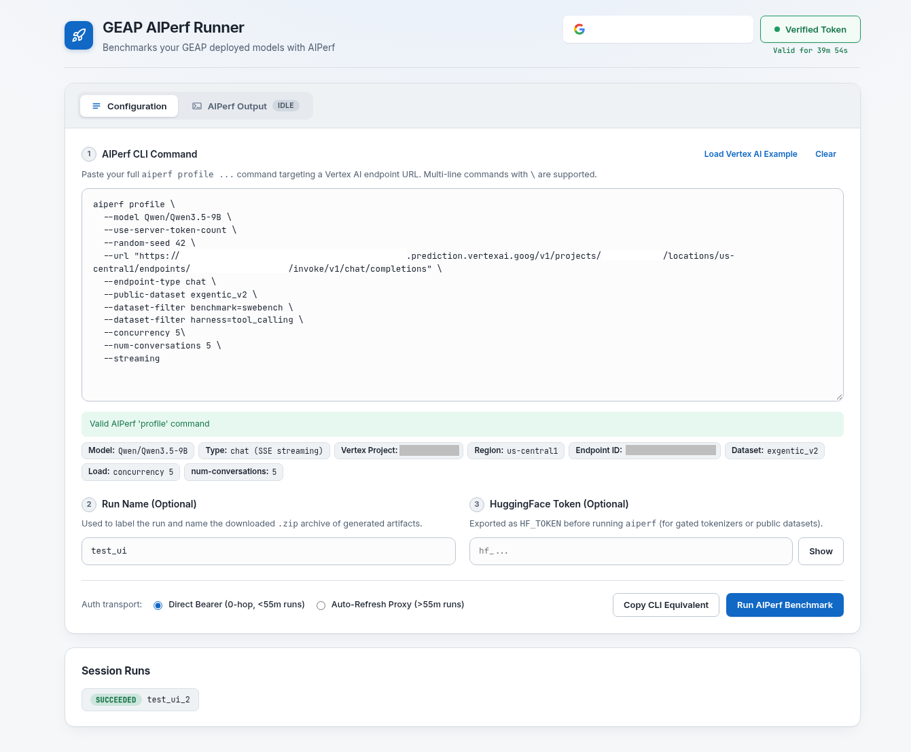

# GEAP AIPerf Runner

<p>
  
  
  
  
  
  
  
  
  
  
  
</p>

Lightweight Web & CLI wrapper for running **NVIDIA AIPerf** (`aiperf`) LLM performance benchmarks against **Google Cloud Vertex AI Endpoints** authenticated with **your Google Account (OAuth 2.0)**.



## Features

- **Google Account Login (OAuth 2.0 + PKCE)**:
  - Authenticate directly via **Sign in with Google** (`http://localhost:<port>/` loopback callback) and verify active token validity with **Verify Token**.
- **AIPerf CLI Command Editor & Inspector**:
  - Generous multi-line script editor supporting `\` line continuations, real-time validation against AIPerf's configuration resolver, and metadata tiles (`Model`, `Type`, `Vertex Project`, `Region`, `Endpoint ID`, `Dataset`, `Load`, `num-conversations`).
- **Backend Selector & Hardware Characteristics**:
  - Built-in catalog of 29 Google Cloud GPU machine backends across the **A2** (`NVIDIA A100 40GB / 80GB`), **A3** (`NVIDIA H100 / H200`), **A4** (`NVIDIA B200`), **A4X** (`NVIDIA GB200`), **G2** (`NVIDIA L4`), and **G4** (`NVIDIA RTX PRO 6000`) series.
  - Displays live hardware specs (`Chip Name`, `Accelerator Type`, `Accelerator Count`, `Total VRAM`, `Memory Bandwidth`, `Hourly Cost`, and `Description`) upon selection, supports `--backend` in CLI mode, and persists `geap_run_metadata.json` in the run's artifact folder so backend metadata surfaces in **Past Runs & Metrics**.
- **Custom Run Name & `.zip` Archive**:
  - Optional Run Name field used to label the run, name its artifact folder, and name the downloaded `<run_name>.zip` archive when downloading all generated artifacts.
- **Optional HuggingFace Token (`HF_TOKEN`)**:
  - Masked secret input in the Web UI (and `--hf-token` in CLI mode) exported as `HF_TOKEN` for gated tokenizers and HuggingFace-hosted datasets.
- **Two Credential Transport Modes**:
  - **Direct Bearer Mode (default, 0-hop)**: Injects your Google OAuth2 Bearer token directly into AIPerf in memory (never exposed in `ps aux` or exported JSON artifacts).
  - **Auto-Refresh Proxy Mode (`>55m` runs)**: Routes traffic through a local `127.0.0.1` streaming reverse proxy (`aiohttp`) that forwards SSE chunks unbuffered while automatically renewing your 60-minute OAuth2 token via `refresh_token`.
- **Verbatim AIPerf Output & Generated Files Export**:
  - Dedicated **AIPerf Output** tab streaming `aiperf`'s exact ASCII/Unicode console output and formatted layout live over SSE, listing all generated files, and providing one-click download of all generated artifacts in a single `.zip` archive.
- **Past Runs & Side-by-Side Metrics Analysis (`artifacts/`)**:
  - Dedicated **Past Runs & Metrics** tab that automatically discovers historical runs inside `artifacts/` (parsing `profile_export_aiperf.json`, `profile_export_aiperf.csv` fallback, nested sweep folders, and per-request `profile_export.jsonl` traces, while flagging cancelled/incomplete log-only runs).
  - **Single-Run Analysis**: Select one run to inspect KPI tiles, an interactive SVG **Latency Percentile Spread** (`p25–p75` IQR, `p50` median, `avg`, `p90`/`p99` tail markers), **Prefill (`TTFT`) vs. Decode Time Composition**, **Per-Request Latency Histograms & Token-Length Scaling Scatter Plots**, and a full statistical table (`avg`, `p50`, `p90`, `p95`, `p99`, `min`, `max`, `std`).
  - **Multi-Run Comparison**: Select two or more runs to compare metrics side-by-side at any statistic (`avg`, `p50`, `p90`, `p95`, `p99`, `min`, `max`) with **Grouped Latency & Throughput Bar Charts**, **Tail-Latency Percentile Curves (`p10` → `p99`)**, a **Throughput vs. Latency Pareto Frontier** plot, configurable **Baseline** `% Δ` improvement/regression badges, category filters, per-run `.zip` downloads, and one-click **Export CSV**.

## Quick Start

### 1. Install Dependencies & Configure `.env`

Create a Python virtual environment, install dependencies, and create a `.env` file in the repository root with your Google Cloud OAuth 2.0 Desktop App credentials (used for the local `http://localhost:8080/` PKCE sign-in flow):

```bash
python3 -m venv .venv
.venv/bin/pip install -r requirements.txt
```

Create `.env` (ignored by Git):

```ini
GOOGLE_OAUTH_CLIENT_ID=your-oauth-client-id.apps.googleusercontent.com
GOOGLE_OAUTH_CLIENT_SECRET=your-oauth-client-secret
```

*(You can create an OAuth 2.0 Client ID of type **Desktop app** in the Google Cloud Console under **APIs & Services → Credentials**.)*

### 2. Start the Web Application

```bash
.venv/bin/python app.py
```

Open **http://localhost:8080** in your browser:
1. Click **Sign in with Google** (and optionally **Verify Token**).
2. In the **Configuration** tab, enter your `aiperf profile ...` command (replacing `YOUR-PROJECT-NUMBER` and `YOUR-ENDPOINT-ID` with your deployed Vertex AI endpoint), optionally select your **Backend** (e.g. `a3-highgpu-8g`) and **Run Name**, and click **Run AIPerf Benchmark** to stream live output in the **AIPerf Output** tab.
3. Open the **Past Runs & Metrics** tab to analyze a single run or select multiple runs from `artifacts/` for side-by-side comparison, interactive latency/throughput/Pareto charts, and CSV export.

### 3. Run via Terminal CLI Wrapper (Optional)

```bash
.venv/bin/python app.py --cli \
  --backend a3-highgpu-8g \
  --cmd 'aiperf profile --model Qwen/Qwen3.5-9B --use-server-token-count --random-seed 42 --url "https://[ENDPOINT-ID].us-central1-[PROJECT-ID].prediction.vertexai.goog/v1/projects/[PROJECT-ID]/locations/us-central1/endpoints/[ENDPOINT-ID]/invoke/v1/chat/completions" --endpoint-type chat --public-dataset exgentic_v2 --dataset-filter benchmark=swebench --dataset-filter harness=tool_calling --concurrency 5 --num-conversations 100 --streaming'
```

## Running Tests

The unit and end-to-end test suite spins up local mock Google OAuth 2.0 and Vertex AI SSE servers automatically—no `.env` file or live Google Cloud endpoint is required:

```bash
.venv/bin/python -m unittest discover -s tests -v
```
